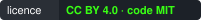
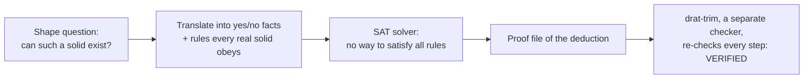

# Szilassi polyhedra: two computer-assisted theorems

**Every ring of seven hexagons in which each face shares an edge with every other has exactly one un-dented face, and the next possible solid of this kind, with twelve faces, cannot have any symmetry: two computer-assisted proofs, each with proof files an independent checker reads.**

[](https://doi.org/10.5281/zenodo.23003257)  [](https://github.com/Hashirama1337s)

Moki & Julio · 2026 · version 1.1

**Read** [TECHNICAL.md](TECHNICAL.md) · **Part A** [convex7/README.md](convex7/README.md) · **Re-run** `python reproduce.py hashes`

## In plain words

Most solids you know have faces that touch only a few others. A cube's top face never touches its bottom. Only two
polyhedra are known in which **every** face shares an edge with every other face: the tetrahedron, with 4 triangles,
and Szilassi's polyhedron (1977), a ring-shaped solid, like a lumpy bagel, made of 7 hexagons.

Szilassi's hexagons are mostly dented: they have corners that point inwards. In 2009 Grünbaum and Szilassi conjectured
that every ring-shaped polyhedron built only from hexagons has at least six dented faces. **Part A** settles the
seven-hexagon case for rings where each face shares an edge with every other (the technical phrase is "no two faces
overarching"). The search covers every possible shape of that kind, not just Szilassi's model. Every one has exactly
one un-dented face: never two, never none.

**Part B** looks one step further. The next possible "every face touches every other" polyhedron would have 12 faces.
Whether it exists has been open since the 1970s. We proved it cannot have any symmetry: no rotation, reflection or
other distance-preserving motion, apart from doing nothing, maps it onto itself. Whether a lopsided one exists is still open.

A picture that helps: **proving a sudoku has no solution.** You could try every filling, but a written chain of
deductions ("this square must be 3, so that one cannot be ...") ending in a contradiction is a proof anyone can
re-check line by line. Here the "squares" are yes/no facts about the shape (which side of each face's plane each corner
lies on), the "rules" say the faces may not cross each other, a SAT solver does the deducing, and it writes its chain
to a proof file that a separate small program re-checks.

Where the picture breaks: a sudoku's rules are exact. Here the rules are necessary conditions that every real solid
must meet, written by us as code, so the proof is only as good as that translation. That is why each translation was
tested against exact geometry, and for Part A written twice, independently. Extra solutions to the puzzle would be
harmless (they might not be real shapes); "no solution" is the answer that counts.

## At a glance

*The exact claims, for specialists. Terms are explained in "How it works" and "Words you will meet".*

- **Part A (v1.1, [`convex7/`](convex7/README.md)).** Let P be an acoptic polyhedral torus, in the sense of Grünbaum
  and Szilassi (2009, p. 21), with exactly seven faces, all hexagons, no two of them overarching. Then exactly one face
  of P is convex. This confirms their Conjecture 5.7 (p. 33), with equality, for seven-face hexangulations without
  overarching faces; those *with* overarching faces are not covered. Two independently written encodings (ENC1
  `code/omsat.py` with `orient`; ENC2 `code/enc2_core.py`) give UNSAT for "≥ 2 convex" and "no convex", every proof
  checked by drat-trim.
- **Part B (v1.0).** No polyhedron with 12 faces in which every two faces share an edge has a non-trivial symmetry.
  Reduction (via the 59 neighbourly genus-6 triangulations and Aut(map)) to 36 SAT instances in an oriented-matroid
  (chirotope) encoding, all UNSAT with DRAT proofs verified by drat-trim. A second, independently derived encoding
  agrees on every case it completed; its half-turn runs did not finish at a 4-hour cap, so the half-turn cases rest on
  the main encoding's certificates alone.
- **Context.** The 59 maps are not regular, so Part B does not settle existence. Bokowski and H. (2025) conjecture
  that an embeddable regular map is also embeddable with a symmetry; under that heuristic (which does not
  literally cover these maps), the theorem is strong evidence that no 12-face Szilassi polyhedron exists.

Full technical record: [TECHNICAL.md](TECHNICAL.md).

## What we do not claim

- Seven-hexagon rings *with* overarching faces, and anything with eight or more faces (Part A).
- Whether a 12-face Szilassi polyhedron without symmetry exists: open (Part B). Long runs on several maps (up to 5 h
  plus 4 h) resolved none.
- Whether all 15 oriented-matroid classes found in Part A are realisable as actual solids.
- The SAT encodings use necessary conditions only; their correctness rests on the encoders, which are checked against
  exact geometry. For Part B's half-turn cases there is no second encoding.
- A referee reported, post hoc and without a certificate here, that the Part A upper bound may need fewer conditions,
  so a short hand proof may exist. Not checked.

## How it works

### The idea



Some words. A face is **convex** (un-dented) if none of its corners point inwards. A corner that points inwards is
**reflex**. Two faces are **overarching** if they meet in more than one place; for seven hexagons, "no two overarching"
is the same as "every two share an edge".

### A worked example

**Part A in numbers.** Seven hexagons, each sharing an edge with each other one, give 7 × 6 / 2 = 21 edges. Euler's
formula for a ring (a torus) then forces 14 corners where faces meet, with exactly three faces at each. That pins
down one fixed pattern of faces and corners, Szilassi's map, so only the shape can vary. The computer asks two
questions about that map: "can at least two faces be convex?" and "can no face be convex?". Both come back UNSAT (no
solution), each with a proof that drat-trim verifies.

As a check, Szilassi's published coordinates, in exact fractions: all seven faces are flat, the solid is embedded (no
faces cross), 8 of its 42 face corners are reflex, and exactly one face, the one in the plane z = 4, is convex.

**Part B in numbers.** A 12-face version would have twelve dented 11-sided faces, 44 corners and 66 edges, on a surface
with six holes (genus 6). There are exactly 59 possible patterns of how its faces could meet. A symmetry of the solid
would have to be a symmetry of its pattern, and that reduces the question to 25 cases (21 half-turns and 4 three-fold
rotations). With the larger groups as extra checks, that makes 36 SAT problems, all UNSAT. The fastest proof (the
12-element group T on pattern #54) takes 7 seconds; the half-turn cases take 3 to 135 minutes each.

## Reproduce and reuse

Questions this lets you answer:

- Do the proof instances really encode what they claim? (Rebuild every CNF and compare its SHA-256 with the table.)
- Is my own polyhedron embedded, with no faces crossing? (An exact checker reads any surface as JSON.)
- Can I attack the open case, lopsided 12-face polyhedra, myself? (The encoder writes those instances.)

**Rebuild and compare** (Python 3 with numpy; `controls` also needs python-sat). From the top folder:

```
git clone https://github.com/Hashirama1337s/szilassi-12
cd szilassi-12
python reproduce.py hashes        # ends "ALL 36 CNFs REPRODUCED"
python reproduce.py controls      # 7-face instance SAT; encoding vs geometry: 0 mismatches
cd convex7
python convex7.py checks          # seconds: ends "CHECKS PASS"
python convex7.py cnf             # ends "ALL 18 CNFs REPRODUCED"
```

To re-prove the instances themselves you also need CaDiCaL and drat-trim (on Windows, with the one-line binary-mode
patch in [`PATCHES.md`](PATCHES.md)). From the top folder:

```
python reproduce.py prove 54 T --cadical PATH --drat-trim PATH      # 10 seconds end to end
python reproduce.py prove 48 C2 --cadical PATH --drat-trim PATH     # about 6 minutes
cd convex7 && python convex7.py prove --cadical PATH --drat-trim PATH   # Part A, seconds (--full: 10-15 more min)
```

**Check your own polyhedron.** `code/checkerB.py` decides, in exact rational arithmetic, whether a polyhedral surface is
embedded. Input is JSON: `{"vertices": [["x", "y", "z"], ...], "faces": [[i0, i1, ...], ...]}`, with coordinates as
exact fractions written as strings.

```
python code/checkerB.py code/checkerB_tests/case08.json
# case08: EMBEDDED V=14 E=21 F=7 genus=1
```

On all 14 test polyhedra in `code/checkerB_tests/` it agrees with the separately written checker `code/check.py`.

**The open case.** `python code/write_cnf.py MAP full orient` writes the asymmetric instance for map number MAP (1 to
59) as a DIMACS CNF into `cnf/`, for anyone with a cluster or a new idea. A cube-based estimate puts these instances several
orders of magnitude beyond one PC.

## Words you will meet

- **Polyhedron** - a solid bounded by flat polygon faces.
- **Convex face** - a face with no corner pointing inwards; **reflex corner** - a corner that points inwards.
- **Torus / genus** - a ring shape; genus counts the holes (a bagel has 1; the 12-face case would have 6).
- **Overarching faces** - two faces that meet in more than one place.
- **Embedded** - built in real space with no faces crossing or piercing each other.
- **SAT solver** - a program that decides whether a large set of yes/no rules can all be satisfied at once.
- **UNSAT** - "no assignment satisfies all the rules".
- **DRAT proof / drat-trim** - a file recording the solver's deduction, and a small program that re-checks it.
- **CNF** - the standard text format for such a set of rules.
- **Symmetry** - a rotation, reflection or other distance-preserving motion that maps the solid onto itself.

## How to cite

```
Moki & Julio (2026). Szilassi polyhedra: every seven-hexagon torus without overarching faces has exactly one convex face, and no symmetric 12-face Szilassi polyhedron exists (computer-assisted proofs with DRAT certificates). Version 1.1. Zenodo. https://doi.org/10.5281/zenodo.23003257
```

The DOI always resolves to the newest archived version. Version 1.0 (Part B only) is 10.5281/zenodo.23003258. Machine-readable: [CITATION.cff](CITATION.cff).
Text and data are under CC BY 4.0 (`LICENSE`); code is under the MIT licence (`LICENSE-CODE`).

## Related projects

- [moki-julio-circle-packing](https://github.com/Hashirama1337s/moki-julio-circle-packing): record packings of equal circles, spheres and hyperspheres, with exact certificates
- All projects: [the Moki & Julio lab map](https://github.com/Hashirama1337s)

---

*Prepared with AI assistance; what was checked, and by what, is stated above.*
